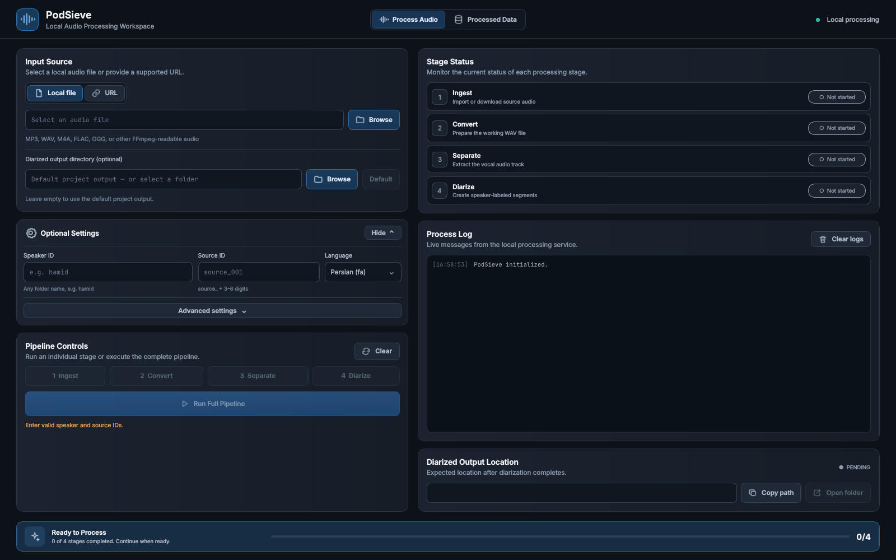
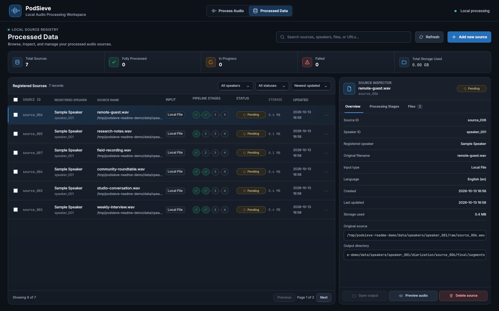

# PodSieve — Speaker Diarization & Vocal Separation Desktop App

**Local-first audio workflow for speaker diarization, vocal separation, and speaker-labeled dataset preparation — with a native Qt/QML desktop UI and Python CLI.**

PodSieve combines **audio ingestion**, **FFmpeg conversion**, **BS-RoFormer vocal separation**, and **pyannote speaker diarization** in a local pipeline. Import your own recordings or supported YouTube/Castbox URLs, run processing stages individually or in sequence, inspect generated artifacts, and export speaker-grouped WAV clips for review or dataset preparation.

**Use cases:** podcast preprocessing · interview segmentation · multi-speaker audio organization · speech dataset curation. Speaker diarization estimates *who spoke when*; it does **not** identify real-world speakers or transcribe speech.

> Processing runs locally on your machine. URL ingestion and first-time model downloads require internet access. An NVIDIA GPU is recommended for the pinned CUDA environment.

**[Quick start](#quick-start) · [Screenshots](#screenshots) · [Features](#features) · [Ubuntu installation](#install-on-ubuntu-with-uv) · [Windows installation](#install-on-windows-with-uv) · [CLI reference](#use-the-cli) · [Contributing](CONTRIBUTING.md)**

```text
Local file / YouTube / Castbox
             ↓
           Ingest → Convert to WAV → Separate vocals → Diarize
                                                         ↓
                                            RTTM · JSON · Speaker WAVs
```

## Quick start

After installing [uv](https://docs.astral.sh/uv/getting-started/installation/), Python 3.10, and the [platform prerequisites](#requirements):

```bash
git clone https://github.com/rezasouri/podsieve.git
cd podsieve
uv python install 3.10
uv sync --locked
uv run --locked python ui/main.py
```

You can also run `uv run --locked python run.py --help` for the CLI.

**Before diarization:** accept the gated pyannote model terms and configure your Hugging Face token as described in [token setup](#hugging-face-token-setup). See the platform-specific installation sections for FFmpeg, graphics/runtime requirements, and CUDA notes. The Windows GPU/model path is not yet end-to-end validated.


## Screenshots

### Process audio and monitor each stage



### Browse processed audio sources



*Screenshots use locally generated demonstration audio and sample source metadata.*

## Contents

- [Quick start](#quick-start)
- [Features](#features)
- [Desktop UI or CLI?](#desktop-ui-or-cli)
- [Requirements](#requirements)
- [Install on Ubuntu with uv](#install-on-ubuntu-with-uv)
- [Install on Windows with uv](#install-on-windows-with-uv)
- [Hugging Face token setup](#hugging-face-token-setup)
- [Use the desktop UI](#use-the-desktop-ui)
- [Use the CLI](#use-the-cli)
- [Configuration and models](#configuration-and-models)
- [Outputs](#outputs)
- [Diarization quality analysis](#diarization-quality-analysis)
- [Troubleshooting](#troubleshooting)
- [Development and contributing](#development-and-contributing)
- [Security policy](SECURITY.md)
- [Changelog](CHANGELOG.md)
- [Who is PodSieve for?](#who-is-podsieve-for)
- [Project status and limitations](#project-status-and-limitations)

## Features

- **Native desktop UI:** responsive Qt Quick/QML interface powered by PySide6,
  with pipeline controls, live logs, stage status, and a processed-source manager.
- **Python CLI:** run ingestion, conversion, separation, diarization, and quality
  analysis as individual commands for repeatable workflows.
- **Local files and URLs:** import FFmpeg-readable audio, including MP3, WAV,
  FLAC, M4A and OGG, or download supported YouTube and Castbox sources.
- **Vocal separation:** produce vocals and instrumental audio with
  `audio-separator` and the configured BS-RoFormer checkpoint.
- **Speaker diarization:** identify who spoke when using `pyannote.audio` and
  export RTTM, JSON, and speaker-grouped WAV segments.
- **Source organization:** track metadata, processing stages, manifests, sizes,
  and artifacts without mixing different sources.
- **Quality review:** retain model evidence, rank suspicious segments and overlap
  candidates, and export review clips. See the [quality guide](docs/DIARIZATION_QUALITY.md).
- **UI conveniences:** choose a custom output folder, use a human-readable speaker
  ID, preview audio, copy artifact paths, and clear the processing form.

Speaker diarization assigns labels such as `SPEAKER_00`; it does not transcribe
speech or automatically identify people by their real names.

## Who is PodSieve for?

| If you need to… | PodSieve provides… |
| --- | --- |
| Prepare podcast/interview audio | Import local files or supported URLs and extract vocals |
| Export diarized training candidates | Speaker-grouped WAV clips, annotations, and manifests |
| Inspect processing history | A native desktop view of sources, stages, and artifacts |
| Automate a repeatable local workflow | A Python CLI for individual processing stages |
| Find potentially unreliable segments | Quality analysis reports and review-clip exports |

## Project status and limitations

PodSieve is an early-stage project (`0.1.0`). It uses gated third-party model weights, and its quality-analysis output is **not** a guarantee of clean speaker labels. GPU/model processing on Windows has not yet been validated end to end. The QML desktop interface and CLI share the processing pipeline, but some UI-only output and naming conveniences are not available through the CLI.

Feature requests, bug reports, reproducible test cases, and contributions are welcome. See [CONTRIBUTING.md](CONTRIBUTING.md). If PodSieve is useful to your audio workflow, consider starring the repository to make it easier for others to discover.

## Desktop UI or CLI?

| Workflow | Desktop UI | CLI |
| --- | --- | --- |
| Start | `uv run --locked python ui/main.py` | `uv run --locked python run.py --help` |
| Processing | Individual stages or Run Full Pipeline | Individual stage commands |
| Speaker ID | Folder names such as `hamid` | `speaker_` followed by 3–6 digits |
| Source ID | `source_` followed by 3–6 digits | Same pattern |
| Output location | Optional custom final-audio destination | Configured data root or `--data-root` |
| Browse results | Search, filters, stage history, files, audio preview | Output files and metadata |
| Hugging Face token | First-run dialog when `.env` is missing | `.env` or an environment variable |

The desktop application calls the same processing stages as the CLI. UI aliases
and custom exports are handled by the desktop adapter; CLI ID rules remain intact.

## Requirements

- **Ubuntu/Linux or native Windows x64**, with platform-specific setup below.
- **Python 3.10**, installed and managed by [`uv`](https://docs.astral.sh/uv/).
- **FFmpeg** on `PATH` for audio conversion and decoding.
- **NVIDIA GPU and compatible driver** for the locked CUDA 12.8 PyTorch stack.
  Some processing paths can select CPU, but a complete CPU-only installation is
  not validated for this dependency set.
- **Node.js** for YouTube downloads using the configured yt-dlp JavaScript runtime.
  Install a current LTS release from the [official Node.js downloads](https://nodejs.org/en/download).
- **Hugging Face account and token** with access to the configured gated models.
- Disk space for dependencies, model weights, original audio, intermediate files,
  and exported segments. Models are downloaded/cached as needed.

## Install on Ubuntu with uv

Run these commands in an Ubuntu terminal. A graphical session is needed for the
UI; the CLI can run without a desktop.

### 1. Install system tools and Qt runtime libraries

```bash
sudo apt update
sudo apt install -y git curl ffmpeg libsndfile1 libegl1 libopengl0 libxcb-cursor0 libxkbcommon-x11-0 libxcb-icccm4 libxcb-image0 libxcb-keysyms1 libxcb-render-util0
```

Install Node.js from its [official installation guide](https://nodejs.org/en/download)
if you plan to import YouTube URLs. Local files do not need Node.js.

### 2. Install uv and clone PodSieve

```bash
curl -LsSf https://astral.sh/uv/install.sh | sh
```

Open a new terminal so `uv` is on `PATH`, then:

```bash
git clone https://github.com/rezasouri/podsieve.git
cd podsieve
uv python install 3.10
uv sync --locked
```

`uv sync --locked` creates `.venv` and installs the dependency versions recorded
in `uv.lock`. There is no need to activate the virtual environment.
See the [official uv installation instructions](https://docs.astral.sh/uv/getting-started/installation/)
for other installation methods.

### 3. Check the environment and launch

```bash
ffmpeg -version
uv run --locked python -c "import torch; print('PyTorch:', torch.__version__); print('CUDA available:', torch.cuda.is_available()); print('GPU:', torch.cuda.get_device_name(0) if torch.cuda.is_available() else 'unavailable')"
uv run --locked python ui/main.py
```

For URL ingestion, also check `node --version`.

## Install on Windows with uv

Use **64-bit Windows 10/11 and PowerShell**. Python dependencies are installed
natively with uv; no Linux environment is needed. The lockfile resolves Windows
packages, but an end-to-end GPU/model run on Windows has not yet been verified.

### 1. Install Windows prerequisites

- Install [Git for Windows](https://git-scm.com/downloads/win).
- Install the [Microsoft Visual C++ Redistributable (x64)](https://learn.microsoft.com/en-us/cpp/windows/latest-supported-vc-redist).
- Install an NVIDIA driver compatible with CUDA 12.8 if using GPU processing.
- Download a **64-bit shared FFmpeg 6.x or 7.x build** using the providers linked
  on the [official FFmpeg downloads page](https://ffmpeg.org/download.html#build-windows).
  Extract it to, for example, `C:\Tools\ffmpeg`, and add its `bin` directory to
  your user `PATH`. Keep the DLLs alongside `ffmpeg.exe`; an executable-only
  static build is insufficient for TorchCodec audio decoding.
- For YouTube ingestion, install [Node.js LTS](https://nodejs.org/en/download).

Open a new PowerShell window and check:

```powershell
git --version
ffmpeg -version
node --version
```

The pinned [TorchCodec installation guide](https://github.com/meta-pytorch/torchcodec/blob/v0.7.0/README.md#installing-torchcodec)
documents its FFmpeg requirements. Windows uses the CPU-decoding TorchCodec wheel;
PyTorch model inference still uses the CUDA build. The UI and CLI entry points
register the FFmpeg executable directory for Windows DLL loading.

### 2. Install uv and project dependencies

```powershell
powershell -ExecutionPolicy ByPass -c "irm https://astral.sh/uv/install.ps1 | iex"
```

Reopen PowerShell after installing uv, then:

```powershell
git clone https://github.com/rezasouri/podsieve.git
cd podsieve
uv python install 3.10
uv sync --locked
```

Python 3.10 is installed by uv; a separate Python installer or virtual-environment
activation is not required. Run the commands from the cloned project directory.

### 3. Check audio decoding and launch

```powershell
uv run --locked python -c "from src.core.runtime import configure_audio_runtime; configure_audio_runtime(); import torch, torchcodec; print('PyTorch:', torch.__version__); print('CUDA available:', torch.cuda.is_available()); print('TorchCodec:', torchcodec.__version__)"
uv run --locked python ui/main.py
```

For the CLI:

```powershell
uv run --locked python run.py --help
uv run --locked python run.py ingest --speaker-id speaker_001 --source-id source_001 --input-file "C:\Users\YourName\Music\audio.mp3"
```

If a dependency needs compilation on your machine, install
[Visual Studio Build Tools](https://visualstudio.microsoft.com/visual-cpp-build-tools/)
with **Desktop development with C++**, then retry `uv sync --locked`.
If TorchCodec reports missing DLLs, check the shared FFmpeg version, its `bin`
entry in `PATH`, and the Visual C++ runtime before running diarization.

## Hugging Face token setup

The default `pyannote/speaker-diarization-3.1` pipeline needs model access under
**the same Hugging Face account that owns your token**.

1. [Create a Hugging Face account](https://huggingface.co/join) or sign in.
2. Open [pyannote/speaker-diarization-3.1](https://huggingface.co/pyannote/speaker-diarization-3.1)
   and accept its access conditions.
3. Open [pyannote/segmentation-3.0](https://huggingface.co/pyannote/segmentation-3.0)
   and accept its access conditions too.
4. Open [Access Tokens](https://huggingface.co/settings/tokens) and create a token
   with **Read** access, or a fine-grained token with read access to the required
   gated models. Copy the token, which starts with `hf_`.

See the official [Hugging Face access-token guide](https://huggingface.co/docs/hub/security-tokens)
for token creation and permissions. Creating a token alone does not grant access
to a gated model; you must also accept its conditions.

**Desktop UI:** start `uv run --locked python ui/main.py`. If the project has no
`.env`, the startup dialog asks for your token. **Save token** creates `.env`
containing `HF_TOKEN` and makes it available in the current session. **Later**
skips setup until the next launch. An existing `.env` is never overwritten.

**CLI or manual setup:** create `.env` in the project root, beside `run.py`, and
replace the placeholder with your token:

```dotenv
HF_TOKEN=hf_your_access_token_here
```

Both workflows load `.env` for processing. An existing `HF_TOKEN` environment
variable takes precedence when the backend loads `.env`. Keep this file private:
`.env` is Git-ignored, and the UI does not display or log saved tokens. If you need
to change an existing token, edit `.env` locally.

## Use the desktop UI

```bash
uv run --locked python ui/main.py
```

1. Open **Process Audio** and choose a local file or supported URL.
2. Enter a speaker ID such as `hamid` and a source ID such as `source_001`.
3. Optionally select an output directory and adjust language/model settings.
4. Run **Ingest → Convert → Separate → Diarize**, or choose **Run Full Pipeline**.
5. Inspect logs and open the output folder when processing finishes.

**Processed Data** lists registered sources with search, filters, storage totals,
processing stages, and artifact browsing. Audio preview uses actual source files.
Source deletion requires typing the source ID and moves that source's owned files
to local trash; other sources remain intact.

**Clear** resets the processing form, settings, logs and stage display. It keeps
stored audio and metadata. The processing page opens with blank IDs and unstarted
stages; entering an existing ID pair loads that source's saved stage status.

The optional UI output directory controls the final-audio export. For example,
choosing a destination with speaker ID `hamid` creates a `hamid` folder there,
with WAV files grouped by detected speaker. Intermediate files and metadata remain
in the configured project data root. See the [desktop UI guide](ui/README.md) for
export naming, deletion behavior, and current limitations.

## Use the CLI

Run commands from the repository root. Replace audio paths with your own. The one-line examples work in Bash and
PowerShell. Use the same IDs for all stages: `speaker_001` / `source_001`, with
3–6 digits after each prefix.

### 1. Import a local audio file

```bash
uv run --locked python run.py ingest --speaker-id speaker_001 --source-id source_001 --input-file "path/to/audio.mp3"
```

Or import a YouTube or Castbox URL:

```bash
uv run --locked python run.py ingest --speaker-id speaker_001 --source-id source_001 --url "https://www.youtube.com/watch?v=VIDEO_ID"
```

Use either `--input-file` or `--url`. Optional speaker metadata: `--name`,
`--gender`, and `--language`.

### 2. Convert to WAV

```bash
uv run --locked python run.py convert --speaker-id speaker_001 --source-id source_001
```

### 3. Separate vocals and instrumental audio

```bash
uv run --locked python run.py separate --speaker-id speaker_001 --source-id source_001
```

Use `--keep-work-dir` to retain temporary separation chunks.

### 4. Diarize speakers and export segments

```bash
uv run --locked python run.py diarize --speaker-id speaker_001 --source-id source_001
```

Use `--num-speakers 2` if you know the expected speaker count. Evidence capture
and quality analysis are enabled by default; to skip both additional passes,
add `--no-save-evidence --no-quality-analysis`.

Each stage accepts `--overwrite` to regenerate existing output deliberately.
There is no CLI `full` command; run the four commands in sequence.

## Configuration and models

[`configs/default.yaml`](configs/default.yaml) controls storage, sample rates,
chunking, URL download options, model selection, evidence and quality settings.
Pass `--config path/to/config.yaml` before the stage name to use another file.

- **Separation:** the default checkpoint is
  `model_bs_roformer_ep_317_sdr_12.9755.ckpt`. `audio-separator` loads it from
  `checkpoints/` and can download supported models on first use. Model weights
  are not included in Git.
- **Diarization:** `pyannote/speaker-diarization-3.1` and its model dependencies
  are fetched from Hugging Face; the default cache is `checkpoints/huggingface/`.
- **YouTube cookies:** the default configuration reads cookies from Chrome on
  the machine running PodSieve. Change `download.cookies_from_browser`, provide
  a Netscape-format `download.cookies_file`, or set both to `null` to disable
  cookies. A cookie file takes precedence; Castbox does not use these settings.
- **Storage:** `storage.data_root` defaults to `data/`. CLI `--data-root` changes
  the storage root for a command; the UI custom destination exports final audio.

## Outputs

By default, outputs are written under `data/`:

```text
data/
├── manifests/
│   ├── speakers.csv
│   └── sources.csv
└── speakers/
    └── speaker_001/
        ├── metadata.json
        ├── raw/
        ├── wav/
        ├── separated/
        │   └── source_001/
        │       ├── vocals.wav
        │       └── instrumental.wav
        └── diarization/
            └── source_001/
                ├── annotation/
                │   ├── diarization.json
                │   └── diarization.rttm
                ├── final/
                │   ├── segments/
                │   │   ├── SPEAKER_00/
                │   │   └── SPEAKER_01/
                │   ├── manifest.csv
                │   └── manifest.json
                └── diagnostics/
                    ├── evidence/
                    │   ├── manifest.json
                    │   └── *.npy
                    └── quality/
                        ├── suspicious_segments.csv
                        ├── overlap_candidates.csv
                        ├── quality_summary.json
                        └── review_clips/
                            ├── suspicious/
                            ├── groups/
                            └── overlap/
```

Set another storage directory in the config, or override it for one invocation:

```bash
uv run python run.py --data-root /path/to/audio-data ingest \
  --speaker-id speaker_001 \
  --source-id source_001 \
  --input-file /path/to/audio.mp3
```

## Diarization quality analysis

Re-rank saved evidence without rerunning the diarization model:

```bash
uv run --locked python run.py analyze-diarization --speaker-id speaker_001 --source-id source_001 --overwrite
```

To add evidence to older results, explicitly rerun diarization on the saved vocals:

```bash
uv run --locked python run.py upgrade-diarization-evidence --speaker-id speaker_001 --source-id source_001 --num-speakers 2 --overwrite
```

Reports appear under `diarization/diagnostics/quality/`. Final WAV segments are
selected to avoid ranked review windows and detected output overlaps. These
heuristics support listening review; they do not guarantee correct speaker labels
or clean training data. Read the [diarization quality guide](docs/DIARIZATION_QUALITY.md)
for evidence requirements, report fields, and scoring limitations.

## Troubleshooting

| Problem | What to check |
| --- | --- |
| `uv` is not found | Reopen the terminal after installing uv and check `uv --version`. |
| CUDA is unavailable | Check your NVIDIA driver with `nvidia-smi` and the PyTorch check above. |
| FFmpeg is missing | Install FFmpeg and make sure `ffmpeg -version` works in the same terminal. |
| Qt cannot load the `xcb` plugin on Ubuntu | Install the Qt runtime libraries listed in the Ubuntu instructions and use a graphical desktop session. |
| YouTube download fails | Check Node.js, network access, yt-dlp errors and cookie settings. |
| Model download returns 401/403 | Check your token, its read permissions, and acceptance of both pyannote model access conditions. |
| Existing output blocks a stage | Use `--overwrite` only when replacing that stage's output is intended. |
| Setup dialog does not appear | The dialog opens only when `.env` is absent; edit an existing `.env` locally if needed. |

For command options:

```bash
uv run --locked python run.py --help
uv run --locked python run.py ingest --help
uv run --locked python run.py diarize --help
uv run --locked python run.py analyze-diarization --help
```

## Development and contributing

The project uses Python for processing and Qt Quick/QML for its desktop UI.

| Path | Purpose |
| --- | --- |
| `run.py` | CLI entry point |
| `src/` | Ingestion, conversion, separation, diarization and shared storage logic |
| `ui/` | Native desktop application, Python bridge and QML components |
| `configs/default.yaml` | Pipeline defaults |
| `docs/DIARIZATION_QUALITY.md` | Evidence and quality-analysis documentation |

Run the test suite with:

```bash
uv run --locked python -m unittest discover -s tests -v
```

For UI-only checks without running large models:

```bash
uv run --locked python -m unittest discover -s tests -p "test_ui*.py" -v
```

Bug reports should include your operating system, GPU/driver, command or UI steps,
and relevant logs with tokens, cookies and personal paths removed. For changes,
keep UI-specific behavior separate from CLI validation and include relevant checks.

## License and model terms

PodSieve's original source code is licensed under the [MIT License](LICENSE).
You may use, modify, and redistribute it, including commercially, subject to
the MIT notice requirements. Third-party libraries, fonts, separation checkpoints,
and pyannote model weights have their own licenses and access terms; the MIT
license does not override them. Check those terms before redistribution or
commercial use.
